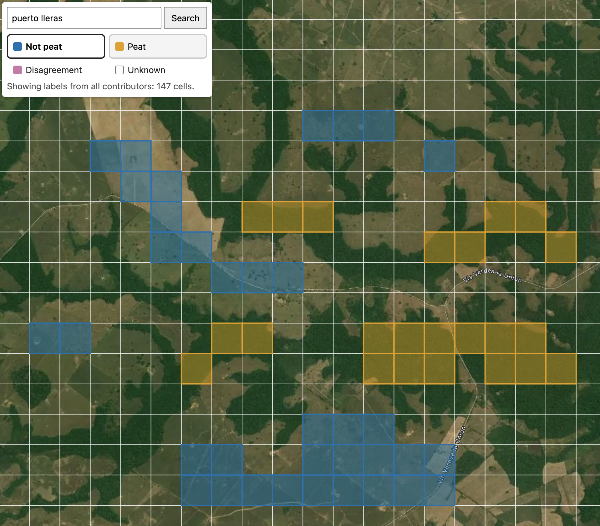
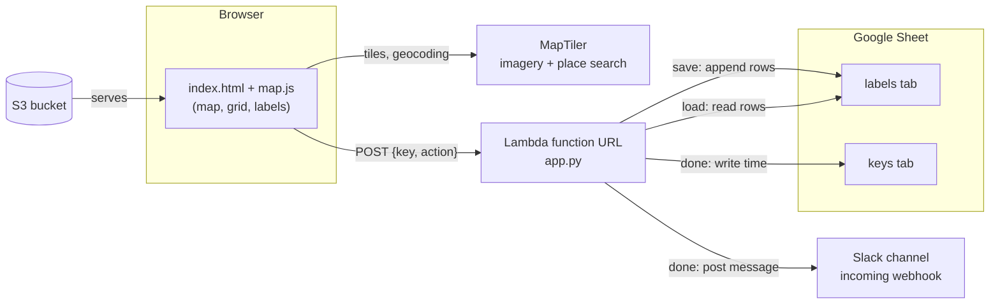

# labeler

Label grid cells as peat or not peat to improve the Peat-ML model.

Labels save to a Google Sheet as you click. Each contributor
gets a personal link with a key.

## Using it

Open your personal link. To start at a specific place, add `lat` and `lng` in decimal degrees (west and south are negative). 

### Label

1. Search for a place, or zoom in until the grid appears.
2. Pick a mode: **Not peat** (blue) or **Peat** (orange).
3. Click cells to label them . Clicking a cell that has the other label switches it to the current mode.

Labels save automatically every few seconds; the box at the bottom left shows
"Saving…", then "Saved ✓".

Click a cell again with the same mode selected to clear it. The sheet is
append-only, so clearing writes a new `unknown` row instead of deleting.

Open the same link. Your earlier labels load and draw on the map. When zoomed
out past the grid, labeled cells show as numbered circles per label (e.g. an
orange circle with 5 = five peat cells nearby).

Click **I'm done** when you finish a session. It records the time in the
`keys` sheet. You can keep labeling.

## Architecture

- **Page** ([web/index.html](web/index.html), [web/map.js](web/map.js)): static files served from
  S3. It computes the grid itself; a cell ID is `row_col` on the 7.5″ grid.
  Clicks queue labels; the page sends batches every 2.5 seconds,
  retrying on failure.
- **Lambda** ([lambda/app.py](lambda/app.py)): validates the key against
  `keys.json` (built into the image) and runs one of three actions:
  - `save` — append `server_time, key, cell_id, latitude, longitude, label`
    rows to the `labels` tab.
  - `load` — return the last label per (key, cell) in sheet order, for this
    key only.
  - `done` — write the time to this key's `completed` column in `keys`, then
    post the contributor's email and peat / not peat counts to Slack (see
    [Slack notifications](#slack-notifications)). A Slack failure is logged
    and doesn't fail the request.
- **Google Sheet**: all storage. `labels` is append-only, so the latest row for
  a (key, cell) is that contributor's current label. Contributors cannot delete
  data.

### Setup and deploy

Settings live in `local.env` (copy from
[local.env.example](local.env.example)). Run targets from this directory, or
from the repo root as `make labeler-TARGET`.

- `make keys` — append 20 new keys to the `keys` tab and regenerate
  `lambda/keys.json`. Redeploy afterwards so the Lambda knows them.
- `make export` — write current labels to `data/labels.csv`; see
  [Export labels](#export-labels).
- `make deploy` — build the Lambda image, push it to ECR, update the function.
- `make site` — fill the API URL and MapTiler key into the page and upload it
  to S3. The page is at `SITE_URL/index.html`, where `local.env` builds
  `SITE_URL` from `SITE_BUCKET` and `AWS_REGION`.
- `make logs` — tail the Lambda's logs.
- [scripts/aws_setup.sh](scripts/aws_setup.sh) — one-time creation of the
  function, its public URL, and the public bucket.

### Slack notifications

Clicking **I'm done** posts a message like
`a@example.org finished labeling: 42 peat, 17 not peat`
to a Slack channel. To set it up once:

1. Go to <https://api.slack.com/apps>, choose **Create New App**, then
   **From scratch**, and pick the workspace.
2. In the setup wizard, add the `incoming-webhook` scope. Add no events.
   Finish the wizard; if it offers to install the app, pick the channel and
   choose **Allow**.
3. On the app's settings page, open **Incoming Webhooks** and turn on
   **Activate Incoming Webhooks**. If no URL is listed under **Webhook URLs
   for Your Workspace**, choose **Add New Webhook** and pick the channel. To
   post to a different channel later, add another webhook.
4. Copy the webhook URL into `SLACK_WEBHOOK_URL` in `local.env`. It's a
   secret: anyone who has it can post to the channel.
   [scripts/aws_setup.sh](scripts/aws_setup.sh) sets it on a new function.
   For an existing function, add it in the Lambda console under
   **Configuration > Environment variables > Edit**.
5. Click **I'm done** with a test key and check the channel, or `make logs`
   if nothing arrives.

Leave `SLACK_WEBHOOK_URL` empty to turn notifications off.

### Export labels

1. Set `SHEET_ID` in `local.env`, and put `service-account.json` in this
   directory. The sheet must be shared with the service account.
2. Run `make export` here, or `make labeler-export` from the repo root. To
   write somewhere else, run
   `SHEET_ID=... uv run python scripts/export_labels.py OUTPUT.csv`.
3. Open `data/labels.csv` at the repo root. Git ignores this file.

The CSV has one row per contributor per cell, with the columns
`server_time, key, email, cell_id, latitude, longitude, label`:

- Only each contributor's latest label for a cell is kept. For example,
  `peat` then `not peat` exports as `not peat`.
- Cells whose latest label is `unknown` (cleared) are left out. For example,
  `peat`, `not peat`, `unknown` exports no row.
- If two contributors label the same cell differently, both rows are kept.
- `email` comes from the `keys` tab and is blank when the key has no email.
