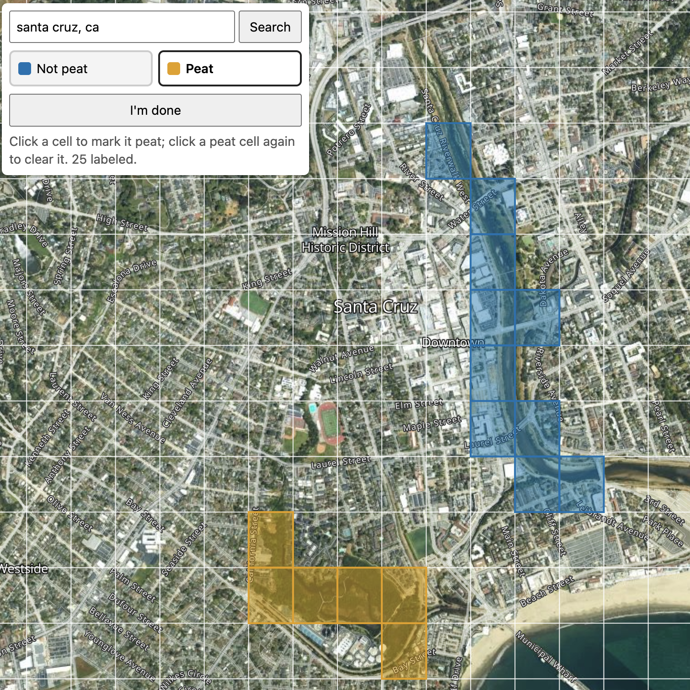
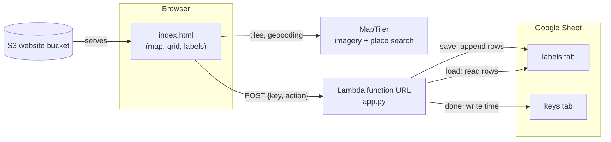

# labeler

Label grid cells as peat or not peat to improve the Peat-ML model.

Labels save to a Google Sheet as you click. Each contributor
gets a personal link with a key.

## Using it

Open your personal link. To start at a specific place, add `lat` and `lng` in decimal degrees (west and south are negative). 

### Label

1. Search for a place, or zoom in until the grid appears.
2. Pick a mode: **Not peat** (blue) or **Peat** (orange).
3. Click cells to label them . Clicking a cell that has the other label switches it to the current mode.

Labels save automatically every few seconds; the box at the bottom left shows
"Saving…", then "Saved ✓".

Click a cell again with the same mode selected to clear it. The sheet is
append-only, so clearing writes a new `unknown` row instead of deleting.

Open the same link. Your earlier labels load and draw on the map. When zoomed
out past the grid, labeled cells show as numbered circles per label (e.g. an
orange circle with 5 = five peat cells nearby).

Click **I'm done** when you finish a session. It records the time in the
`keys` sheet. You can keep labeling.

## Architecture

- **Page** ([web/index.html](web/index.html)): a single static file served from
  S3. It computes the grid itself; a cell ID is `row_col` on the 7.5″ grid.
  Clicks queue labels; the page sends batches every 2.5 seconds,
  retrying on failure.
- **Lambda** ([lambda/app.py](lambda/app.py)): validates the key against
  `keys.json` (built into the image) and runs one of three actions:
  - `save` — append `server_time, key, cell_id, latitude, longitude, label`
    rows to the `labels` tab.
  - `load` — return the last label per (key, cell) in sheet order, for this
    key only.
  - `done` — write the time to this key's `completed` column in `keys`.
- **Google Sheet**: all storage. `labels` is append-only, so the latest row for
  a (key, cell) is that contributor's current label. Contributors cannot delete
  data.

### Setup and deploy

Settings live in `local.env` (copy from
[local.env.example](local.env.example)). Run targets from this directory, or
from the repo root as `make labeler-TARGET`.

- `make keys` — append 20 new keys to the `keys` tab and regenerate
  `lambda/keys.json`. Redeploy afterwards so the Lambda knows them.
- `make deploy` — build the Lambda image, push it to ECR, update the function.
- `make site` — fill the API URL and MapTiler key into the page and upload it
  to S3.
- `make logs` — tail the Lambda's logs.
- [scripts/aws_setup.sh](scripts/aws_setup.sh) — one-time creation of the
  function, its public URL, and the website bucket.
